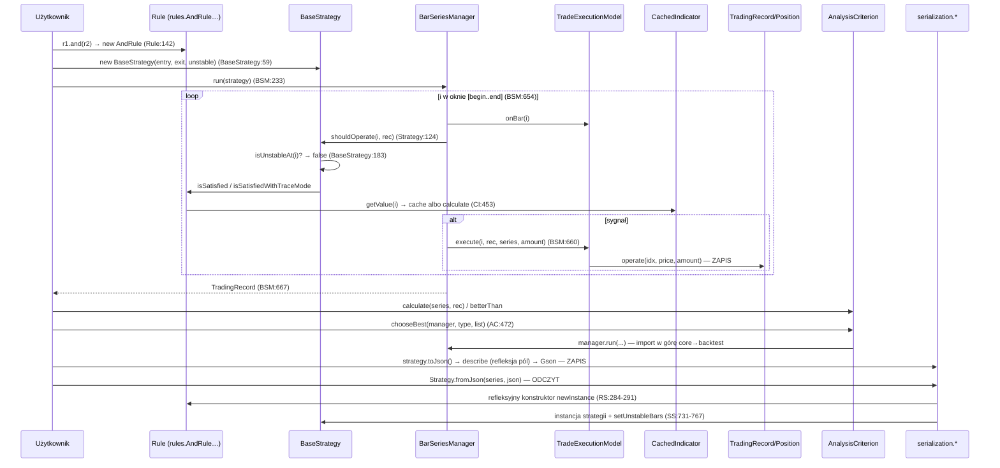

# Research: Strefa ryzyka 4: definiowanie i ocena strategii

**Data**: 2026-10-30T14:01:08+01:00
**Badacz**: Tomasz Kubina (z asystą Claude, 3 równoległe sub-agenty)
**Commit**: e26a1be159bfdbb486690e1108e362036261b5c6
**Gałąź**: docs/territory-map-20261030
**Repozytorium**: ta4j

Ścieżki skrócone: `core/` = `ta4j-core/src/main/java/org/ta4j/core/`, `test/` = `ta4j-core/src/test/java/org/ta4j/core/`.

Znaczniki:
- **[E]** to dowód, czyli przeczytany kod albo wynik komendy, z kotwicą.
- **[I]** to interpretacja.
- **[U]** to biała plama: czego nie ustalono i dlaczego.

## Research Question

Analiza punktu 4 ze stref ryzyka w `context/map/repo-map.md:152-154`: „Definiowanie i ocena strategii: kontrakty reguł, strategii, wskaźników i kryteriów”. Analiza ma trzy wymiary:
1. trace e2e: od entry pointu przez warstwy do zapisu i odczytu, i z powrotem;
2. luki w testach;
3. blast radius, czyli graf statyczny połączony z co-change z gita.

Opisuje tylko stan obecny, bez propozycji implementacji.

## Summary

- **Przepływ ma cztery odcinki** i wszystkie przechodzą przez 4 interfejsy z `core/`:
  1. definicja (`Rule.and/or` → `BaseStrategy`),
  2. wykonanie (`BarSeriesManager.run` → `Strategy.shouldOperate` → `Rule.isSatisfied` → `CachedIndicator.getValue` → `TradingRecord.operate`),
  3. ocena (`AnalysisCriterion.calculate/betterThan/chooseBest`),
  4. utrwalanie (`toJson`/`fromJson` przez pakiet `serialization`, oparty na refleksji).
- **Kontrakty nie są liściowymi abstrakcjami.** Przez metody `default` interfejsy importują w górę: `rules`, `serialization`, `named`, `backtest` i `analysis`. Tabela w TD1 ma 9 wierszy. ast-grep potwierdza 28 deklaracji `import` i 14 krawędzi plik→pakiet (bez `num`). One zamykają cykle pakietów opisane w mapie.
- **Prawdziwy kontrakt utrwalania jest ukryty w nazwach.** Format JSON wynika z nazw pól i parametrów konstruktorów w 69 typach reguł, 338 typach wskaźników (311 plików) i 70 typach kryteriów w `main`. Liczby to domknięcie przechodnie `extends`/`implements` z AST; wcześniejsze „~69/~295/~67” pochodziły z grepa po sufiksie. Kompilator tego nie pilnuje i nie ma narzędzia zgodności API (revapi/japicmp).
- **Testy są dobre na głównej ścieżce** (truth tables reguł, `BarSeriesManager.run`, okna kryteriów, round-trip JSON strategii). Słabe są brzegi kontraktu:
  - `chooseBest` dla SELL, remisu i pustej listy,
  - semantyka `BaseStrategy.and/or/opposite`,
  - 5 z 15 publicznych przeciążeń `run(...)` bez bezpośredniego testu (wcześniej błędnie: „0 trafień” także dla `start > finish`),
  - `toExpression`/`fromExpression` dla Rule i Indicator,
  - domyślne metody interfejsów wywoływane tylko przez implementacje `Rule` jako lambdy w testach (10 miejsc). Implementacji `Strategy` spoza `BaseStrategy` brak.
- **Dwie konkretne niespójności zachowania** (dowód w kodzie, brak testu):
  - `chooseBest` liczy pierwszą strategię bez `tradeType` (`core/AnalysisCriterion.java:474` vs `:478`);
  - `JustOnceRule` ma mutowalny stan bez resetu (`core/rules/JustOnceRule.java:20,54`). Jest jedyną taką regułą: `TriggeredRule` też ma stan, ale sama go resetuje (`core/rules/TriggeredRule.java:307-317`).
- **Kopiowanie strategii jest w pętli backtestu** (nowe, z ast-grep). Przy przeciążeniach z `PositionSizer` każdy sygnał tworzy `PositionSizer.Context`, a ten robi pełną kopię strategii przez serializację (`StrategySnapshots.copy`). Szczegóły w TD7.
- **Korekta sygnału z mapy.** Mapa uzasadnia strefę m.in. tym, że `core` ma 25% poprawek. W commitach dotykających samych 4 interfejsów odsetek „fix” w treści wynosi 0–20%. Mapa sama przypisuje poprawki `core` współbieżnym mutacjom serii (`context/map/artifact-1-territory.md:104`). Ryzyko strefy 4 to więc **zasięg zmiany**, a nie częstość błędów (szczegóły w Historical Context).

---

## 1. Feature overview

### Co robi ta funkcja

Użytkownik biblioteki:
1. składa **reguły** (`Rule`) ze **wskaźników** (`Indicator`),
2. pakuje je w **strategię** (`Strategy`: reguła wejścia, reguła wyjścia, okres niestabilny, kierunek startowy),
3. uruchamia backtest na serii notowań, co daje `TradingRecord` z pozycjami,
4. ocenia wynik **kryteriami** (`AnalysisCriterion`) i może wybrać najlepszą strategię.

Strategię, regułę, wskaźnik i kryterium można zapisać do JSON (albo do zwartego wyrażenia) i odtworzyć.

### Trace e2e: sekwencja kroków

**A. Definicja**
1. `r1.and(r2)` → `new AndRule(r1, r2)`. Podobnie `or` → `OrRule`, `xor` → `XorRule`, `negation` → `NotRule`. [E] `core/Rule.java:142-168`
2. Konstruktor `AndRule` odrzuca `null` (`requireNonNull`) i ustawia nazwę złożoną. [E] `core/rules/AndRule.java:32-36`
3. `new BaseStrategy(entry, exit, unstableBars[, startingType])` przechodzi przez `validateConfig` i zapisuje konfigurację. [E] `core/BaseStrategy.java:59-60,85-86,147`
4. Gettery `getEntryRule`/`getExitRule` zwracają kopię przez `RuleCopies.copy`, czyli serializację i odtworzenie reguły. Przy `RuntimeException` zwracają oryginał. [E] `core/BaseStrategy.java:158,163`; `core/rules/RuleCopies.java:42-51`

**B. Wykonanie (entry point)**

5. `BarSeriesManager.run(strategy)` → `run(strategy, strategy.getStartingType())`. Wszystkie 15 publicznych przeciążeń (`:233-464`) zbiega się w prywatnym `run(..., AmountResolver)`. [E] `core/backtest/BarSeriesManager.java:233-234,634`
   - Ścieżka wsadowa: `BacktestExecutor` buduje `BarSeriesManager` i wywołuje 5-argumentowe `seriesManager.run(strategy, tradeType, amount|positionSizer, start, finish)` w 8 miejscach: amount `:329,457,843,931`, sizer `:357,480,886,955`. Walk-forward robi to samo w `StrategyWalkForwardExecutor.java:220,253`. [E] `core/backtest/BacktestExecutor.java:114-178`
6. Pętla barów:
   - okno jest przycinane pod blokadą odczytu (`currentBounds()`);
   - dla każdego `i` kolejno: `tradeExecutionModel.onBar`, potem `strategy.shouldOperate(i, record)`, a przy sygnale `execute(...)`;
   - na koniec `onRunEnd` i zwrot `TradingRecord`.

   [E] `core/backtest/BarSeriesManager.java:470-472,640-669`
7. `shouldOperate` wybiera `shouldEnter` (pozycja nowa) albo `shouldExit` (pozycja otwarta). W pozostałych przypadkach zwraca `false`. [E] `core/Strategy.java:124-132`
8. `BaseStrategy.evaluateShouldEnter/Exit`:
   - jeśli `isUnstableAt(i)` (`i < unstableBars`), zwraca `false` i loguje „unstable”;
   - w przeciwnym razie wywołuje `isSatisfiedWithTraceMode` (gdy trace jest włączony) albo `isSatisfied`.

   [E] `core/BaseStrategy.java:183,187-240`
9. `AndRule.isSatisfied` ocenia dzieci leniwie (short-circuit) przez `AbstractRule.evaluateChildRule`. Gdy trace jest włączony, owija ocenę w `RuleTraceContext` (stos w `ThreadLocal`). [E] `core/rules/AndRule.java:39-57`; `core/rules/AbstractRule.java:82-102`; `core/rules/RuleTraceContext.java:25`
10. Reguły liściowe wołają `Indicator.getValue(i)`. Pomiędzy jest `CachedIndicator.getValue`, który:
    - synchronizuje cache z rewizją serii;
    - wybiera gałąź: indeks przycięty, ostatni bar (mutowalny) albo `getOrComputeAndCache` → `calculate(i)`.

    Krok reguła → wskaźnik to [I], bo nie przeczytano żadnej reguły liściowej. Zachowanie cache to [E] `core/indicators/CachedIndicator.java:450,453-480`.
11. **Zapis do rekordu.** `TradeOnNextOpenModel.execute` → `tradingRecord.operate(index, price, amount)`. `BaseTradingRecord.operate` bierze blokadę zapisu i tworzy `Position`/`Trade`. [E] `core/backtest/TradeOnNextOpenModel.java:23-27`; `core/TradingRecord.java:69,141,183`; `core/BaseTradingRecord.java:349-356`

**C. Ocena i powrót**

12. Abstrakcyjne są `calculate(series, Position)`, `calculate(series, TradingRecord)` i `betterThan`. [E] `core/AnalysisCriterion.java:136,143,495`
    - Wariant okienkowy rzutuje rekord na okno przez `WindowProjectedTradingRecord`. [E] `core/AnalysisCriterion.java:167,203,354-407`
    - `AbstractAnalysisCriterion` iteruje pozycje i obsługuje pozycje otwarte na końcu. [E] `core/criteria/AbstractAnalysisCriterion.java:65-90`
13. `chooseBest(manager, tradeType, strategies)` wykonuje `manager.run` dla każdej strategii i porównuje wyniki przez `betterThan`. [E] `core/AnalysisCriterion.java:472-487`
14. Ścieżka wsadowa: `BacktestExecutionResult` (`List<TradingStatement>`).
    - `getTopStrategies` liczy `criterion.calculate(barSeries, statement.getTradingRecord())`.
    - `executeAndKeepTopK` sortuje wyniki od najlepszego.

    [E] `core/backtest/BacktestExecutionResult.java:33,495,532,557`; `core/backtest/BacktestExecutor.java:958,1108`

**D. Utrwalanie: zapis i odczyt**

15. `Strategy.toJson()` → `StrategySerialization.describe`. Powstaje drzewo `ComponentDescriptor`:
    - `type` (prosta nazwa klasy, jeśli należy do `core`),
    - `label`,
    - `parameters` (`unstableBars`, `startingType` gdy ≠ BUY),
    - `components` (deskryptory reguł).

    Drzewo zapisuje Gson. [E] `core/Strategy.java:256-257`; `core/serialization/StrategySerialization.java:210-244`; `core/serialization/ComponentSerialization.java:11-50`
16. `Rule.toJson()` → `RuleSerialization.describe`. Odczyt pól idzie przez refleksję (`ConstructorMatch.locate`, `getDeclaredFields` + `setAccessible`). Brak dopasowania kończy się `RuleSerializationException`. [E] `core/Rule.java:55-58`; `core/serialization/RuleSerialization.java:160-169,1899-1908`. `Indicator` działa analogicznie. [E] `core/serialization/IndicatorSerialization.java:890-910`
17. `Strategy.fromJson(series, json)` → `StrategySerialization.fromJson`:
    - najpierw próba formatu v2 (`SUPPORTED_V2_VERSION = 2`);
    - potem `fromDescriptor`: rozwiązanie klasy, `instantiateRule` (refleksyjny `getDeclaredConstructors` + `newInstance`), `setUnstableBars`.

    [E] `core/Strategy.java:348-349`; `core/serialization/StrategySerialization.java:80,256-313,731-767`; `core/serialization/RuleSerialization.java:284-291,377`

### Diagram

### Pokrycie testami ścieżki

Metoda: analiza statyczna przez grep wywołań w `test/` i odczyt trafień. **Nie ma raportu JaCoCo**: `find` po `target/` nic nie zwrócił, a `mvn` nie był uruchamiany. Nie podaję więc procentów linii ani gałęzi [U]. „Brak” oznacza 0 bezpośrednich trafień grepa, a nie dowód braku wykonania pośredniego.

**Infrastruktura [E]:**
- `AbstractIndicatorTest` i `AbstractCriterionTest` są parametryzowane fabryką `Num` (Double i Decimal).
- W `ta4j-core` nie ma Mockito (0 importów). Używane są ręczne atrapy: `FixedRule`, `BooleanRule.TRUE/FALSE`, `MockBarSeriesBuilder` i 10 reguł-lambd. Mockito występuje tylko w 2 testach źródeł danych w `ta4j-examples`.
- Round-trip zapewniają `RuleSerializationRoundTripTestSupport` i `IndicatorSerializationRoundTripTestSupport`.
- W `ta4j-examples` są 69 klas testowych. Żadna nie odwołuje się do `BarSeriesManager`, `BacktestExecutor`, `BaseStrategy`, `chooseBest` ani `shouldOperate`.

| Obszar | Status | Dowód |
|---|---|---|
| `Rule.and/or/xor/negation`, truth tables | Pokryte | `test/rules/AndRuleTest.java:51-59`, `OrRuleTest.java:42-50`, `XorRuleTest.java:42-44`, `NotRuleTest.java:42-43` |
| Odrzucenie `null` w `AndRule`/`OrRule` | Kod jest (`AndRule.java:32-33`), testu brak | 0 `assertThrows` w `AndRuleTest`/`OrRuleTest`. `Not`/`Xor` pokryte (`NotRuleTest:57`, `XorRuleTest:62-63`). |
| Short-circuit `And`/`Or` jako zachowanie | Brak | Widoczny tylko pośrednio w testach logów trace |
| Reguły złożone z niepustym `TradingRecord` | Brak | `And/Or/Xor/NotRuleTest` wołają tylko 1-argumentowe `isSatisfied(i)` (12/9/9/4 razy), które przekazuje `null` (`core/Rule.java:175-176`) |
| `Rule.toJson/fromJson` | Pokryte | `test/serialization/RuleSerializationTest.java:887,897` |
| `Rule/Indicator.toExpression/fromExpression` | Brak bezpośrednio | 0 wywołań. Reguły tylko pośrednio przez `registry.toExpression(RULE, …)` (`test/named/NamedAssetRegistryTest.java:63`). Dla porównania `AnalysisCriterion` ma testy wyrażeń (`AnalysisCriterionSerializationTest:40,47,130,136,167`) |
| `Strategy.toJson/fromJson/toCompactJson` | Pokryte, z SELL i `unstableBars` | `test/serialization/StrategySerializationTest.java:93-125,379-453` |
| `Strategy.toExpression/fromExpression` | Częściowe | Jedno makro `SMA(2,3)` (`StrategySerializationTest:368-373`); warianty z rejestrem: 0 |
| `Strategy.shouldOperate` | Tylko pośrednio | Jedyny call-site to pętla `BarSeriesManager.java:659`. Testy go nie wołają, tylko nadpisują (`BacktestExecutorTest:1086,1260`). Gałąź `return false` niezweryfikowana. |
| `BaseStrategy` konstruktor (walidacja) | Pokryte typy wyjątków, komunikaty nie | `test/BaseStrategyTest.java:20-23` |
| `isUnstableAt` | Pośrednio | `BarSeriesManagerTest:112,599`; granica `index == unstableBars` niezweryfikowana |
| `BaseStrategy.and/or/opposite` | Częściowe | `StrategyStartingTypeTest:42-44` sprawdza tylko `startingType`. Złożone reguły, nazwa, `unstableBars`, zamiana reguł w `opposite`: brak. Przeciążenia `and/or(name, strategy, int)`: 0. |
| `Indicator.stream/toDouble/getDependencies` | Pokryte | `test/indicators/IndicatorTest.java:49-110`, `MACDIndicatorTest:39` |
| `AnalysisCriterion.calculate(..., AnalysisWindow)` | Pokryte dokładnie | `test/analysis/AnalysisWindowTest.java:110-446` |
| `betterThan` | Pokryte per kryterium (168 call-site'ów w 58 plikach) | Remis (równe argumenty): 0 testów |
| `chooseBest(manager, BUY, list)` | Częściowe | `test/criteria/AbstractAnalysisCriterionTest.java:50,58` (2 strategie, BUY) |
| `chooseBest` z SELL, remisem, listą 1-elementową, pustą, oraz wariant 2-argumentowy | Brak | 0 trafień |
| `BarSeriesManager.run` (główne przeciążenia, przycinanie, SELL, otwarte pozycje) | Pokryte | `test/backtest/BarSeriesManagerTest.java:112-1112` |
| `run(s, record, amount, start, finish)` (`:430`), w tym `start > finish` | Pokryte | `BarSeriesManagerTest:754,765,1112`, `TradingRecordParityTest:74`, `ExitOnRunEndModelTest:283-284` (`:284` to `start=2 > finish=1`) |
| `run(s, sizer, start, finish)` (`:352`) | Pokryte | `BarSeriesManagerTest:304` |
| `run(s, record)` `:391`, `run(s, record, amount)` `:405`, `run(s, record, sizer)` `:446`, `run(s, record, sizer, start, finish)` `:464`, `run(s, sizer)` `:335` | Brak bezpośrednio | 0 call-site'ów o tym kształcie. [I] `:391` i `:405` to cienkie delegacje do pokrytego `:430` |
| `BacktestExecutor` (raport, równoległość, top-K, walk-forward) | Pokryte | `test/backtest/BacktestExecutorTest.java:104-1202` |
| `BacktestExecutor` z SELL | Brak | 0 wystąpień „SELL” w `BacktestExecutorTest` |
| Domyślne metody interfejsów: `getStartingType`, `shouldEnter/Exit(int, rec)`, `shouldEnter/ExitWithTraceMode(int, rec, mode)`, `Rule.isSatisfiedWithTraceMode/setName/getName` | `Strategy`: brak. `Rule`: tylko przez 10 reguł-lambd w testach backtestu | `BaseStrategy` nadpisuje `:167,187,197,215,225`, `AbstractRule` nadpisuje `:97,105,110`. Lambdy: `BarSeriesManagerTest:875,958,1031`, `BacktestExecutorTest:357,967,988,1047`, `StrategyWalkForwardExecutorTest:301,328,356` |

---

## 2. Technical debt

Każda pozycja ma dowód [E], interpretację [I] i białe plamy [U]. Kolejność według konsekwencji. To ocena, a nie plan naprawy.

### TD1. Kontrakty `core` zależą od warstw wyższych (cykle pakietów)

[E] Potwierdzone importy w górę z plików kontraktów:

| Z pliku | Import | Użycie |
|---|---|---|
| `core/Rule.java:6-9` | `rules.AndRule/OrRule/XorRule/NotRule` | `and/or/xor/negation` (`:142-168`) |
| `core/Rule.java:10-13` | `named.NamedAssetRegistry`, `serialization.*` | `toJson/fromJson/toExpression` (`:55-133`) |
| `core/Strategy.java:7-9` | `named`, `serialization.StrategySerialization` | `toJson` (`:256`), `fromJson` (`:348`) |
| `core/Indicator.java:7-10` | `named`, `serialization.IndicatorSerialization` | `toJson` (`:127`), `fromJson` (`:260`) |
| `core/AnalysisCriterion.java:20` | **`backtest.BarSeriesManager`** | `chooseBest` (`:460-487`) |
| `core/AnalysisCriterion.java:13-19` | `analysis.*`, `analysis.cost.*` | `calculate` w oknie |
| `core/AnalysisCriterion.java:21-24` | `named`, `serialization.AnalysisCriterionSerialization` | `toJson/fromJson` |
| `core/BaseStrategy.java:9` | `rules.RuleCopies` | `getEntryRule/getExitRule` (`:158,163`) |
| `core/TradingRecord.java:15` | `analysis.cost.CostModel` | — |

Weryfikacja ast-grep (`kind: import_declaration`, regex `org.ta4j.core.[a-z]`): wszystkie linie się zgadzają. Bez `num` to 28 deklaracji importu i 14 krawędzi plik→pakiet: Rule 3, Strategy 2, Indicator 2, AnalysisCriterion 5, BaseStrategy 1, TradingRecord 1. W tabeli są to 9 wierszy.

Zamknięte pętle [E]:
- `rules.RuleCopies` → `serialization.RuleSerialization` (`core/rules/RuleCopies.java:20`) → `rules.helper.ChainLink` (`core/serialization/RuleSerialization.java:14`);
- `StrategySerialization` → `BaseStrategy` (`:28`).

[I] Interfejsy niosą wygodne metody fabryczne i codec jako `default`. Dlatego nie da się zmienić `serialization` ani `rules` bez rekompilacji i ryzyka dla kontraktu. To jest ta „pojedyncza krawędź w górę”, która według mapy spina splot 37 pakietów (`context/map/repo-map.md:171`).

### TD2. Format JSON to niejawny kontrakt oparty na refleksji

[E]
- Serializacja czyta pola przez `getDeclaredFields` + `setAccessible`. Nazwy pól stają się kluczami JSON (`core/serialization/IndicatorSerialization.java:698-726,890-910`; `RuleSerialization.java:1899`).
  - ast-grep: `getDeclaredFields` jest wołane 6 razy w 5 plikach (`RuleSerialization:1899`, `IndicatorSerialization:895`, `AnalysisCriterionSerialization:278,301,337`, `rules/RuleCopies:126`). Do tego 5 × `getDeclaredConstructors`, 23 × `setAccessible` i 24 × `newInstance`, wszystkie w `serialization/*` i `RuleCopies`.
  - Pola `transient` pomijają tylko serializatory reguł (`:1900`) i wskaźników (`:898`). `AnalysisCriterionSerialization` odrzuca tylko `static`/`synthetic` (`:279,302,338`). [I] Pole `transient` kryterium może więc posłużyć jako źródło wartości parametru konstruktora.
- Konstruktory są dobierane po nazwach parametrów. Wymaga to `<parameters>true</parameters>` w `pom.xml:396`.
- Kryteria są szukane w zakodowanej liście 6 pakietów (`core/serialization/AnalysisCriterionSerialization.java:37-40`). ast-grep: dziś wszystkie 70 typów `AnalysisCriterion` w `main` leży w tych 6 pakietach. [I] Kryterium w nowym podpakiecie wypadnie po cichu.
- `NamedAssetRegistry` rejestruje aliasy w 33 wywołaniach `register*` (`core/named/NamedAssetRegistry.java:445-539`): 18 reguł, 9 kryteriów, 5 wskaźników, 1 strategia. W pliku jest 106 literałów w stylu nazw klas (36 różnych). Tylko 13 różnych (68 wystąpień) to rzeczywiste proste nazwy klas, które są kontraktem refleksji; 23 to aliasy (`SMA`, `NetProfit`, `CrossedUp`…). Wcześniejszej liczby „59 literałów w `:197-395`” nie udało się odtworzyć: w tym zakresie są helpery deskryptorów, a nie rejestracje.
- Kanoniczny JSON nie ma pola wersji. Wersję ma tylko zwarty format v2 (`StrategySerialization.java:80,126,309`).
- W pom-ach nie ma revapi, japicmp, clirr ani ArchUnit.

[I] Każda z tych operacji zmienia format bez ostrzeżenia kompilatora:
- zmiana nazwy pola albo parametru konstruktora w regule, wskaźniku czy kryterium,
- przeniesienie klasy do innego pakietu,
- zmiana prostej nazwy klasy.

Zabezpieczeniem są tylko testy serializacji. „Migracje” nie istnieją. Odpowiednikiem są ścieżki zgodności wstecznej: legacy klucze `children`/`baseIndicators` (`core/serialization/ComponentSerialization.java:299-304`) i dyspozycja v2/kanoniczny.

[U] Nie wiadomo, ile JSON-ów użytkownicy trzymają poza repo. W repo nie ma plików golden. JSON komponentów leży inline w 5 klasach testowych `core`: `serialization/{Strategy,Component,AnalysisCriterion,Indicator,Rule}SerializationTest` (43/16/6/5/1 literałów). Do tego dochodzą 3 testy przykładów z JSON `NamedStrategy`. Wcześniejsze „9 klas” obejmowało też JSON domenowy (Elliott ×3, `TradeTest:379`).

### TD3. `chooseBest`: niespójny `tradeType` i nieprzetestowane brzegi

[E]
- Pierwsza strategia jest liczona przez `manager.run(bestStrategy)` (`core/AnalysisCriterion.java:474`), czyli według własnego `getStartingType()`. Pozostałe przez `manager.run(currentStrategy, tradeType)` (`:478`).
- Pusta lista daje `NoSuchElementException` z `getFirst()` (`:473`).
- Testy obejmują tylko BUY i 2 strategie (`test/criteria/AbstractAnalysisCriterionTest.java:50,58`).
- W kodzie produkcyjnym jedynym wywołaniem `chooseBest` jest wewnętrzna delegacja wariantu 2-argumentowego do 3-argumentowego, z wymuszonym BUY (`core/AnalysisCriterion.java:461`). W testach są 2 call-site'y w jednej klasie. Wariant 2-argumentowy ma 0 wywołań. `ta4jexamples/walkforward/WalkForward.java:72,113` to niezwiązana prywatna metoda o tej samej nazwie.

[I]
- Gdy `tradeType=SELL`, a strategie mają domyślny BUY, pierwszy kandydat jest oceniany na innej podstawie niż reszta. Wynik może wtedy wskazać złą strategię.
- Przy remisie wygrywa wcześniejsza strategia, bo `betterThan` jest ostre. Żaden test tego nie utrwala.
- Sama obecność tej metody w interfejsie wymusza import `backtest` (TD1).

### TD4. Stan w regułach a ponowne użycie strategii

[E] `JustOnceRule` ma pole `private boolean satisfied`. Po pierwszym spełnieniu pole zostaje `true` na zawsze. Nie ma resetu ani synchronizacji (`core/rules/JustOnceRule.java:20,45-56`). `BacktestExecutor` uruchamia strategie równolegle, ale po jednym przebiegu na kandydata (`core/backtest/BacktestExecutor.java:51,311-356`).

[I] Ta sama instancja `Strategy` z `JustOnceRule`, uruchomiona drugi raz (np. przez `chooseBest` po wcześniejszym `run`, albo przy wielokrotnym backteście), nie da już sygnału. Kopia przez `getEntryRule()`/`RuleCopies` tworzy nową instancję, ale pętla backtestu używa pól bezpośrednio (`core/BaseStrategy.java:187-240`).

[E] (ast-grep, `field_declaration` bez `final`/`static` w `rules/**`) Pola mutowalne mają tylko:
- `JustOnceRule:20` (`satisfied`),
- `TriggeredRule:152-155` (`transient`, stan ewaluacji) oraz `StageState:486-487`,
- `helper/ChainLink:20,26` (konfiguracja ogniwa),
- `AbstractRule:28` (`volatile name`).

`InPipeRule`, `IsLowestRule` i `TimeRangeRule` nie mają żadnych mutowalnych pól. Jedyny inny stan wykonania to `TriggeredRule`, który resetuje go sam: przy innym `TradingRecord` albo cofnięciu indeksu (`core/rules/TriggeredRule.java:307-317`). `JustOnceRule` jest więc jedyną regułą ze stanem bez resetu.

[U] Nie wiadomo, czy dokumentacja ostrzega przed ponownym użyciem.

### TD5. Domyślne metody bez implementera referencyjnego

[E]
- W `main` jest dokładnie 1 klasa `implements Strategy` (`BaseStrategy.java:14`) i 1 `implements Rule` (`AbstractRule.java:19`). Klas anonimowych `new Rule/Strategy() {…}` brak.
- `BaseStrategy` nadpisuje `getStartingType`, `shouldEnter/Exit(int, rec)` i `shouldEnter/ExitWithTraceMode(int, rec, mode)`. `AbstractRule` nadpisuje `isSatisfiedWithTraceMode(int, rec, mode)`, `setName` i `getName`.
- `Rule` ma 1 metodę abstrakcyjną, więc działa jak interfejs funkcyjny. Testy backtestu mają 10 reguł-lambd, czyli jedyne implementacje `Rule` spoza `AbstractRule`. Wszystkie 11 typów `Strategy` w testach dziedziczą po `BaseStrategy`.
- `Strategy.shouldEnter/shouldExit` w wersji domyślnej wołają `getEntryRule()`/`getExitRule()` na każdym barze (`core/Strategy.java:161,209`).

[I] Domyślne metody to publiczne API, którego używa tylko zewnętrzny implementer, a dla niego są nieprzetestowane. Zewnętrzna `Strategy`, która kopiuje reguły w getterach tak jak `BaseStrategy`, dostawałaby nową kopię reguły na każdym barze. Stan `JustOnceRule` by wtedy nie przetrwał. Pakietów `internal` brak, więc wszystko jest publiczne. Bundle eksportuje `*org.ta4j.core*` (`ta4j-core/pom.xml:117-132`).

### TD6. Dwa niepowiązane pojęcia „niestabilności”

[E]
- Strategia: `unstableBars` i `isUnstableAt(i)` = `i < unstableBars` (`core/BaseStrategy.java:183`).
- Wskaźnik: `getCountOfUnstableBars()` i `isStable()` = `barCount >= getCountOfUnstableBars()` (`core/Indicator.java:51-61`).
- `CachedIndicator` tylko ostrzega, gdy okno jest krótsze niż okres niestabilny (`core/indicators/CachedIndicator.java:453-480`).
- Javadoc `BacktestExecutor` wprost przestrzega, że `isStable()` zależy od barów po ocenianym indeksie (`core/backtest/BacktestExecutor.java:56-59`).

[I] Użytkownik musi ręcznie zgrać `unstableBars` strategii z wskaźnikami w regułach. Kod niczego tu nie wyprowadza.

### TD7. Kopiowanie reguł przez serializację

[E] `getEntryRule`/`getExitRule` oraz `AndRule.getRule1/2` kopiują regułę przez `describe` → `fromDescriptor`. Przy wyjątku po cichu zwracają oryginał (`core/rules/RuleCopies.java:42-51`; `core/rules/AndRule.java:59-66`).

[E] (ast-grep `RuleCopies.copy($$$)`) Wzorzec jest szerszy: 23 call-site'y w 11 plikach.
- Gettery: `BaseStrategy:158,163` oraz `And/Or/Xor/Not/AndWithThreshold/OrWithThresholdRule`, `helper/ChainLink:46`.
- Konstruktory: `LossTriggeredCooldownRule:71`, `TriggeredRule:123-124`.
- Inne: `TriggeredRule:132,136,446`, `LossTriggeredCooldownRule:120`.
- **`backtest/StrategySnapshots.java:23-24`**, czyli kopia całej strategii.

`StrategySnapshots.copy` wołają `PositionSizer.Context` (kanoniczny konstruktor `:262` i akcesor `strategy()` `:272`), `BacktestRuntimeReport:109,115` i `StrategyWalkForwardExecutionResult:77,98`.

[I]
- Defensywna kopia zależy od tego, czy reguła da się zserializować. Reguły lambda i anonimowe wrócą jako oryginał, więc semantyka gettera jest niejednorodna.
- Każde wywołanie gettera to pełny round-trip refleksyjny. **Ścieżka z `PositionSizer` płaci ten koszt w pętli backtestu**: `BarSeriesManager.java:622` (resolver) → `amountForNextOperation:698` → `amountForIndex:680` → `positionSizerContext:709` → `new PositionSizer.Context` → `StrategySnapshots.copy`. To pełna kopia obu reguł przy każdym sygnale. Ścieżka z `amount` kopii nie robi, bo pętla używa pól (`core/BaseStrategy.java:187-240`). Dotyczy to też `BacktestExecutor` (sizer `:357,480,886,955`) i walk-forward (`:253`).
- [U] Nie sprawdzono, czy kopia w `Context` przenosi stan reguł (np. `JustOnceRule.satisfied`). To zależy od tego, czy deskryptor złapie pole niebędące parametrem konstruktora.

Wcześniejsze [U] („czy coś woła gettery w pętli”) jest rozstrzygnięte: tak, ścieżka z sizerem, raport runtime i walk-forward.

### TD8. Rozjazd domyślnego kierunku między wejściami do backtestu

[E]
- `BarSeriesManager.run(strategy)` używa `strategy.getStartingType()` (`core/backtest/BarSeriesManager.java:233-234`).
- `BUY` wymuszają 4 publiczne przeciążenia `BacktestExecutor`: `execute(strategies, amount)` `:217`, `execute(strategies, positionSizer)` `:230`, `executeWithRuntimeReport(…, amount)` `:273` i `executeWithRuntimeReport(…, positionSizer)` `:286` (Javadoc mówi to wprost). To samo robi `AnalysisCriterion.chooseBest(manager, list)` (`:461`).
- Testy `BacktestExecutor` nie zawierają SELL.

[I] Strategia z `startingType=SELL` daje różne wyniki zależnie od tego, czy uruchomi ją manager, czy executor. Javadoc to dokumentuje, ale nie utrwala tego żaden test.

---

## Blast radius

### Graf statyczny [E]

Liczby z ast-grep (`class_declaration` z `superclass`/`super_interfaces`) w `ta4j-core/src/main`, `ta4j-core/src/test` i `ta4j-examples/src`. „Z pośrednimi” to domknięcie przechodnie hierarchii zbudowane z AST wszystkich deklaracji typów, a nie grep po sufiksie nazwy. Format komórki: **pliki** (typy), gdy liczby się różnią. Pierwotne liczby z grepa podano w nawiasie kwadratowym tam, gdzie się rozjechały.

| Szew | main | test | examples |
|---|---|---|---|
| `extends AbstractRule` bezpośrednio | 61 | **5** (10) [grep: 4] | 2 (4) |
| podtypy `Rule` z pośrednimi | 69 (69 typów, 65 konkretnych) | **8** (14) [7] | 3 (5) |
| `extends BaseStrategy` / `extends NamedStrategy` | 1 / **0** [grep: 2] | 3 (5) / 4 (6) | 1 / 3 |
| `new BaseStrategy(`: pliki / call-site'y | 3 / 6 | 24 / 227 | 20 / 26 |
| `extends CachedIndicator<` / `RecursiveCachedIndicator<` bezpośrednio | 205 (217) / 35 (40) | 10 (32) / 3 (7) | 6 (7) / 0 |
| podtypy `Indicator` z pośrednimi | **311** (338 typów, 314 klas konkretnych) [~295] | 44 (95) [34] | 12 (18) [10] |
| `implements Indicator` bezpośrednio (omija `AbstractIndicator`) | 5 + 1 anonimowa (`LPPLResidualIndicator:157`) + 5 pod-interfejsów | 6 (7) + 13 anonimowych | 3 (6) |
| `extends AbstractAnalysisCriterion` bezpośrednio / podtypy `AnalysisCriterion` z pośrednimi | 42 (43) / **69** (70 typów, 61 konkretnych) [~67] | 1 / 7 (10) [2] | 0 |
| Pliki z referencją do typu `TradingRecord` w kodzie | **145** [152] | **78** [81] | 37 |

Rozjazdy z grepem:
- `NamedStrategy` w `main` ma 0 podklas. Grep łapał Javadoc (`NamedStrategy.java:103,148`) i `Class<? extends NamedStrategy>` (`:182,233,254`).
- Grep gubił FQN `extends org.ta4j.core.rules.AbstractRule` (`test/serialization/StrategySerializationTest.java:1413`).
- `TradingRecord` w grepie `-w` liczył też pliki, w których typ pojawia się tylko w Javadoc.

Fan-in z jdeps (mapa, `context/map/artifact-2-structure.md` §3): `criteria` ma 178 zależności między plikami na `core`, `rules` 145, `backtest` 49, `serialization` 15.

Metody abstrakcyjne. Zmiana którejkolwiek łamie wszystkich implementerów. [E]
- `Rule.isSatisfied(int, TradingRecord)` (`core/Rule.java:185`)
- `Strategy`: 11 metod: `getName/getEntryRule/getExitRule`, `and`×2, `or`×2 (z przeciążeniami `(name, strategy, int)` `:84,93`), `opposite/setUnstableBars/getUnstableBars/isUnstableAt` (`core/Strategy.java:38-117`)
- Metod `default` (ast-grep): Rule 13, Strategy 16, Indicator 7, AnalysisCriterion 8. Metod `static`: 3/4/4/13.
- `Indicator`: `getValue/getCountOfUnstableBars/getBarSeries` (`core/Indicator.java:37,61,66`), a w praktyce `CachedIndicator.calculate(int)` (`:450`)
- `AnalysisCriterion`: `calculate` ×2 i `betterThan` (`core/AnalysisCriterion.java:136,143,495`)

### Warstwy pochodne („generowane”) [E]

- **Generowania kodu nie ma.** W pom-ach brak procesorów adnotacji i kodogeneracji.
- Rolę warstwy generowanej pełni **serializacja refleksyjna** (TD2) oraz **rejestr nazw** `NamedAssetRegistry` i `NamedStrategy.registerImplementation` (`core/strategy/named/AGENTS.md`).
- `ReadmeContentManager` synchronizuje fragmenty `README.md` z kodu przykładów (`ta4j-examples/.../doc/ReadmeContentManager.java`). README współzmienia się z `Strategy` w 33% commitów.
- **„Migracje”** to tylko zgodność formatu JSON: v2 plus legacy klucze (TD2). Schematu bazy danych brak, bo to biblioteka.

### Co-change z gita (2025-10-30 → 2026-10-30) [E]

Metoda: `git log --since=2025-10-30 --no-merges --name-only`. Commity dotykające ponad 150 plików odfiltrowano. Fix to commit, którego treść pasuje do `\b(fix|fixes|fixed|bug|bugfix|hotfix)\b`. Baza repo: 333/2262 (14,7%). Skrypt i wynik zostały w scratchpadzie sesji, poza repo.

| Plik | Commity | Fix (treść) | Najczęstsi towarzysze |
|---|---|---|---|
| `Rule.java` | 12 | 0 | `Strategy` 70%, `AbstractRule` 60%, `CHANGELOG` 50%, `OrRule` 50%, `AndRule`/`BaseStrategy`/`StrategyTraceLoggingTest` 40% |
| `Strategy.java` | 17 | 1 | `CHANGELOG` 53%, `Rule` 47%, `StrategySerializationTest` 40%, `StrategySerialization`/`BaseStrategy`/`README` 33% |
| `Indicator.java` | 10 | 2 (jeden to „fixed comments”) | `Strategy`/`Rule` 38%; `BarSeriesManager`, `BacktestExecutor`, `StrategySerialization` 25% |
| `AnalysisCriterion.java` | 14 | 0 | `CHANGELOG` 46%, `AnalysisWindowTest` 38%, `README` 31%, `AnalysisWindowing`/`AnalysisContext` 23% |
| `BaseStrategy.java` | 11 | 1 | — |
| `TradingRecord.java` | 9 | 3 | — |

[I]
- Interfejsy zmieniają się w kampaniach funkcjonalnych, a nie naprawczych: serializacja #1373 (XI 2025), okna kryteriów (II–III 2026), tryby trace (IV–V 2026), skróty named (V 2026), `getDependencies` (VIII 2026).
- Wskaźnik oparty na treści commitów zaniża liczbę poprawek. Na przykład „Handle live open lots in windowed criteria” czy „Harden rule trace diagnostics” to poprawki bez słowa „fix” [U: brak mapowania fix→PR, `fixpr.py` nie był uruchamiany].

### Co musi zmienić się razem (graf statyczny + co-change)

| Zmieniasz | Musisz też ruszyć |
|---|---|
| `Rule` | `AbstractRule` (`:97-122`), `And/Or/Not/XorRule`, `Strategy` (trace defaults `:175-240`, co-change 70%), `RuleSerialization`, `RuleCopies` (23 call-site'y) / `BaseStrategy` / `StrategySnapshots`, 69 typów reguł, 10 reguł-lambd w testach backtestu, wskaźniki budujące reguły (np. `NumericIndicator:292-341`), testy `rules/*Test`, `StrategyTraceLoggingTest`, `RuleSerializationTest`, `RuleNameTest` |
| `Strategy`/`BaseStrategy` | `NamedStrategy` i jego podklasy, `StrategySerialization` (v2, domyślny typ `"BaseStrategy"` `:79`), `NamedAssetRegistry` (`:244,345`), 259 wywołań `new BaseStrategy(` w 47 plikach (6 w `main`), `StrategySerializationTest`, JSON w testach przykładów, `README.md` |
| `Indicator` | `AbstractIndicator`/`CachedIndicator`/`RecursiveCachedIndicator`, 5 pod-interfejsów i bezpośrednich implementerów, 338 typów wskaźników w 311 plikach, `IndicatorSerialization`. Przy `getDependencies`: unieważnianie cache (strefa 2 mapy). Do tego `BarSeriesManager`/`BacktestExecutor` (co-change 25%) i atrapy w testach przykładów. |
| `AnalysisCriterion` | `AbstractAnalysisCriterion`, 70 typów kryteriów, `ReturnCriterion`, `AnalysisCriterionSerialization` (lista pakietów), `backtest.BarSeriesManager` (`chooseBest`), `analysis.AnalysisWindow/Context/OpenPositionHandling/cost`, `WindowProjectedTradingRecord`, testy okien i serializacji |
| Model `TradingRecord/Position/Trade` | `BaseTradingRecord`, `WindowProjectedTradingRecord`, 3 implementacje testowe, `analysis.cost`, 145 plików main |
| Zawsze | `CHANGELOG.md` → `Unreleased` (+ `### Breaking`) według `PULL_REQUESTS.md:9`, `@since` (`core/AGENTS.md`), Javadoc, pełna bramka `scripts/run-full-build-quiet.sh` (`core/serialization/AGENTS.md`). Kompatybilności binarnej nic nie pilnuje. |

---

## Weryfikacja strukturalna (ast-grep)

Metoda: `ast-grep 0.51.0` (`run -l java -p …` oraz `scan --inline-rules` z regułami `kind`/`has`/`inside`). Każde zero z ast-grep zostało sprawdzone kontrolnym `grep`/`grep -P`, żeby odróżnić realny brak wystąpień od złego wzorca. Dwa zera okazały się błędem wzorca, a nie brakiem wystąpień:
- `kind: text_block` nie istnieje w gramatyce Javy (literały JSON);
- `-p 'Trade.TradeType.BUY'` nie dopasował `field_access`.

Oba poprawiono regułą (`kind: string_literal`, `kind: field_access`), a wyniki pokryły się z grepem. Ograniczenie [U]: ast-grep nie zna typów, więc przypisanie wywołań `run(...)` do przeciążeń opiera się na liczbie i kształcie argumentów (nazwy zmiennych `*Record`, `*Sizer`).

| # | Twierdzenie (miejsce) | Werdykt | Dowód |
|---|---|---|---|
| 1 | `chooseBest`: 0 wywołań w produkcji, 1 w testach (TD3) | doprecyzowane | main: 1 delegacja 2-arg → 3-arg (`AnalysisCriterion.java:461`). Testy: 2 call-site'y (`AbstractAnalysisCriterionTest.java:50,58`). `WalkForward.java:72,113` to inna metoda o tej samej nazwie. |
| 2 | `chooseBest` liczy 1. strategię bez `tradeType` (`:474` vs `:478`) | potwierdzone | `$M.run($$$)` wewnątrz `chooseBest` daje dokładnie `:474 manager.run(bestStrategy)` i `:478 manager.run(currentStrategy, tradeType)`; `getFirst()` `:473`. |
| 3 | 1 `implements Strategy` i 1 `implements Rule` w main (TD5) | potwierdzone + doprecyzowane | `BaseStrategy.java:14`, `AbstractRule.java:19`. Anonimowych 0 (grep 0). W testach jest 10 reguł-lambd (lista w TD5). |
| 4 | `BaseStrategy`/`AbstractRule` nadpisują domyślne metody | potwierdzone, lista pełniejsza | `BaseStrategy:167,187,197,215,225`; `AbstractRule:97,105,110`. |
| 5 | Metody abstrakcyjne: Rule 1, Strategy „9”, Indicator 3, AC 3 | doprecyzowane | Strategy ma 11 (`and`/`or` ×2, `:69,75,84,93`). Pozostałe zgodne: `Rule:185`, `Indicator:37,61,66`, `AC:136,143,495`. |
| 6 | „9 krawędzi” importów w górę (TD1) | doprecyzowane | Wszystkie importy potwierdzone. Precyzyjnie: 28 importów, 14 krawędzi plik→pakiet. |
| 7 | `Rule.and/or/xor/negation` → `new And/Or/Xor/NotRule` | potwierdzone | `Rule.java:143,151,160,167`. |
| 8 | Wszystkie przeciążenia `run` zbiegają się w prywatnym `run(…, AmountResolver)` (`:631`) | potwierdzone, linia poprawiona | 15 publicznych przeciążeń `:233-464`, prywatne `:634` (`:631` to Javadoc). |
| 9 | „5 przeciążeń `run(s, record…)` i `run(s, sizer)`; `start > finish`: 0 trafień” | **częściowo obalone** | `run(s, record, amount, start, finish)` ma 6 wywołań w testach; `start > finish` jest testowane w `ExitOnRunEndModelTest:284`; `run(s, sizer, start, finish)` w `BarSeriesManagerTest:304`. Bez testu: `:335,391,405,446,464`. |
| 10 | `BacktestExecutor` woła `run(…, amount, start, finish)` w `:329,357` | doprecyzowane | 8 call-site'ów (4 amount + 4 sizer) oraz 2 w `StrategyWalkForwardExecutor:220,253`. |
| 11 | `shouldOperate` tylko z pętli `BSM:659` | potwierdzone | Jedyny call-site `BarSeriesManager.java:659`; w testach tylko nadpisania `BacktestExecutorTest:1086,1260`. |
| 12 | Pętla barów: `onBar` → `shouldOperate` → `execute` → `onRunEnd` | potwierdzone | `BarSeriesManager.java:657,659,660,667`. |
| 13 | Kopie przez `RuleCopies` w getterach `BaseStrategy` i `AndRule` (TD7) | doprecyzowane (szerzej) | 23 call-site'y w 11 plikach, w tym `StrategySnapshots:23-24`. |
| 14 | „W gorącej pętli backtestu koszt kopii nie występuje” (TD7) | **obalone dla ścieżki z `PositionSizer`** | `BSM:622→698→680→709` → `PositionSizer.Context:262` → `StrategySnapshots.copy`. |
| 15 | Mutowalny stan tylko sprawdzony w `JustOnceRule` (TD4 [U], OQ2) | rozstrzygnięte | Pola niefinalne w `rules/**`: `JustOnceRule:20`, `TriggeredRule:152-155,486-487`, `ChainLink:20,26`, `AbstractRule:28`. `InPipeRule`/`IsLowestRule`/`TimeRangeRule`: 0. |
| 16 | `extends NamedStrategy` w main: 2 | **obalone** | 0 podklas; grep łapał Javadoc i generyki (`NamedStrategy.java:103,148,182,233,254`). |
| 17 | `extends AbstractRule` w testach: 4 pliki | **obalone** | 5 plików / 10 klas; grep gubił FQN (`StrategySerializationTest.java:1413`). |
| 18 | ~69 reguł / ~295 wskaźników / ~67 kryteriów | doprecyzowane | 69 / 338 typów (311 plików) / 70 typów (69 plików), domknięcie z AST. |
| 19 | `new BaseStrategy(` 3/24/20 plików, „47 miejsc” | doprecyzowane | Pliki zgodne (47), ale call-site'ów jest 259 (6/227/26). |
| 20 | `TradingRecord` w 152/81/37 plikach | doprecyzowane | Referencje w kodzie: 145/78/37 (reszta to tylko Javadoc). |
| 21 | `NamedAssetRegistry`: 59 literałów nazw klas `:197-395` | **obalone (nieodtwarzalne)** | 33 × `register*` w `:445-539`; 13 różnych prawdziwych nazw klas (68 wystąpień) i 23 aliasy. |
| 22 | Kryteria szukane w 6 pakietach (`:37-40`) | potwierdzone | `CRITERIA_PACKAGES` ma 6 pozycji; wszystkie 70 typów kryteriów w nich leży (30/26/5/5/3/1). |
| 23 | Refleksja czyta pola niestatyczne i nie-`transient` (TD2) | doprecyzowane | 6 × `getDeclaredFields` w 5 plikach (też `RuleCopies:126`). Filtr `transient` tylko w Rule/Indicator; kryteria go nie mają. |
| 24 | `AndRuleTest`/`OrRuleTest`: 0 `assertThrows`; `NotRuleTest:57`, `XorRuleTest:62-63` | potwierdzone | ast-grep i grep zgodne. |
| 25 | Testy kompozytów przekazują `null` albo nic | doprecyzowane | Wyłącznie 1-arg `isSatisfied(i)` → `null` (`Rule.java:175-176`); jedyne 2-arg to `super.isSatisfied` w atrapie (`AndRuleTest:233`). |
| 26 | `Rule/Indicator.toExpression/fromExpression`: 0 trafień | potwierdzone, z dopiskiem | 0 (grep 0). Pośrednio `NamedAssetRegistryTest:63`. Kryteria mają testy wyrażeń. |
| 27 | `Strategy.toExpression`: jedno makro `SMA(2,3)` | potwierdzone | `StrategySerializationTest:371,373`. |
| 28 | `betterThan` ~200 trafień, remis 0 | doprecyzowane / potwierdzone | 168 call-site'ów w 58 plikach (grep 191 linii z komentarzami). Remis: 0 dla `$C.betterThan($A, $A)`, `$C.betterThan($F($A), $F($A))` i `grep -P` z backreferencją. |
| 29 | `and/or(name, strategy, int)`: 0 w testach | potwierdzone | 0 (grep 0); `opposite()` 1× (`StrategyStartingTypeTest:44`). |
| 30 | `BacktestExecutorTest`: 0 × SELL | potwierdzone | 0 (grep 0). |
| 31 | Brak Mockito | doprecyzowane | `ta4j-core`: 0; `ta4j-examples`: 2 testy źródeł danych. |
| 32 | `ta4j-examples`: 69 klas testowych bez BSM/Executor/BaseStrategy/`chooseBest`/`shouldOperate` | potwierdzone | 69 `*Test.java` (+2 pomocnicze); identyfikatory 0 (grep `-w` 0). |
| 33 | JSON komponentów inline w 9 klasach testowych | doprecyzowane | 9 plików ma literał z `"type":`, ale komponentowy JSON jest w 5 (`serialization/*`) + 3 testach przykładów. |
| 34 | `BacktestExecutor` wymusza BUY (`:216-218`) | doprecyzowane | 4 publiczne przeciążenia: `:217,230,273,286` (+ `AnalysisCriterion:461`). |
| 35 | `implements Indicator` bezpośrednio 5/6/3 | potwierdzone + dopisek | Pliki zgodne; dodatkowo 1 klasa anonimowa w main, 13 w testach, 5 pod-interfejsów. |

---

## Code References

- `core/Rule.java:6-13,55-58,142-168,185` – importy w górę, codec, kombinatory, metoda abstrakcyjna
- `core/Strategy.java:124-132,256-257,348-349` – `shouldOperate`, `toJson`, `fromJson`
- `core/BaseStrategy.java:59-60,147,158,163,183,187-240` – konstrukcja, kopie reguł, `unstableBars`, ewaluacja
- `core/Indicator.java:37,51-61,127-128,260` – kontrakt wartości, stabilność, codec
- `core/AnalysisCriterion.java:20,136,143,167,354-407,460-495` – import `backtest`, `calculate`, okna, `chooseBest`, `betterThan`
- `core/backtest/BarSeriesManager.java:233-234,470-472,631-669` – entry point i pętla
- `core/backtest/BacktestExecutor.java:51-59,216-218,311-356` – tryb wsadowy, domyślny BUY, równoległość
- `core/rules/AndRule.java:32-66`, `core/rules/AbstractRule.java:82-110`, `core/rules/RuleCopies.java:42-51,126,143`, `core/rules/JustOnceRule.java:20,45-56`, `core/rules/TriggeredRule.java:152-155,307-317`
- `core/backtest/StrategySnapshots.java:21-25`, `core/backtest/PositionSizer.java:262,272`, `core/backtest/BarSeriesManager.java:622,680,698,709` – kopia strategii przy każdym sygnale na ścieżce z sizerem
- `core/indicators/CachedIndicator.java:450-480` – cache i `calculate`
- `core/serialization/StrategySerialization.java:80,210-313,731-767`, `RuleSerialization.java:160-169,284-291,377,1899`, `IndicatorSerialization.java:698-726,890-910`, `AnalysisCriterionSerialization.java:37-40`, `ComponentSerialization.java:299-304`
- `pom.xml:396` – `<parameters>true</parameters>` (warunek działania refleksji po nazwach parametrów)

## Architecture Insights

- **Wzorzec „interfejs + baza abstrakcyjna + wiele płytkich klas”** (`AbstractRule`, `CachedIndicator`, `AbstractAnalysisCriterion`). Zmiana wewnątrz liścia jest tania. Zmiana szwu kosztuje dziesiątki do setek plików.
- **Interfejsy jako fasady.** Kombinatory (`and/or`), codec (`toJson/fromJson`) i orkiestracja (`chooseBest`) siedzą w metodach `default`. Wygoda API jest okupiona cyklami pakietów (TD1).
- **Utrwalanie jest refleksyjne i konwencyjne**, a nie deklaratywne. Konwencje opisują pliki `AGENTS.md` w `serialization/` i `strategy/named/`, a nie typy.
- **Bezpieczeństwo współbieżne** przeniesiono do `CachedIndicator`, `BaseTradingRecord` (blokady) i `RuleTraceContext` (`ThreadLocal`). Reguły jako takie nie mają kontraktu wielowątkowości (TD4).

## Historical Context (from prior changes)

- W `context/changes/` i `context/archive/` nie ma wcześniejszych zmian. Katalogi utworzono dziś przez `/10x-init`.
- Ocena twierdzeń z `context/map/repo-map.md:152-154`, każde osobno:
  - „Największy zasięg zmiany (`criteria` 178 i `rules` 145)”: **potwierdzone** (jdeps w `artifact-2-structure.md` §3, uzupełnione liczbami implementerów powyżej).
  - „Importy w górę (`AndRule`, `BarSeriesManager`, serializatory)”: **potwierdzone** (`Rule.java:6-9`, `AnalysisCriterion.java:20`, `Rule/Strategy/Indicator/AnalysisCriterion` → `serialization`). Lista mapy nie jest wyczerpująca: dochodzą `named`, `analysis`, `analysis.cost` i `rules.RuleCopies`.
  - „`core` ma najwyższy odsetek poprawek (25%)”: **częściowo**. Liczba jest zgodna z `artifact-1-territory.md:104` (47/187), ale ten sam wiersz przypisuje poprawki współbieżnym mutacjom serii (strefa 1). Dla samych 4 interfejsów odsetek fix w treści commitów wynosi 0/12, 1/17, 2/10 i 0/14. Ten sygnał nie wspiera więc strefy 4 jako „miejsca błędów”, tylko `core` jako pakiet.
  - „Brak pakietów `internal`, więc każda zmiana dotyczy publicznego API”: **potwierdzone** (`-exportcontents: *org.ta4j.core*`, `ta4j-core/pom.xml:117-132`).

## Related Research

Nie dotyczy. Brak innych `research.md` w `context/changes/**` i `context/archive/**`. Materiał wejściowy: `context/map/repo-map.md`, `artifact-1-territory.md`, `artifact-2-structure.md`.

## Open Questions

1. Procentowe pokrycie linii i gałęzi ścieżki. Wymaga uruchomienia JaCoCo, którego raportu nie ma.
2. ~~Czy inne reguły mają mutowalny stan jak `JustOnceRule`.~~ Rozstrzygnięte przez ast-grep (TD4): tylko `TriggeredRule`, który resetuje się sam.
3. Ile poprawek kryje się pod commitami bez słowa „fix” (mapowanie fix→PR przez `context/map/scripts/fixpr.py`).
4. Krok reguła liściowa → wskaźnik nie został odczytany na konkretnej regule (np. `CrossedUpIndicatorRule`).
5. Wpływ na JSON przechowywany poza repo. Kanoniczny format nie ma wersji.
6. Czy `chooseBest:474` (pominięcie `tradeType`) jest zamierzone. W kodzie i Javadoc nie ma uzasadnienia, `CHANGELOG` nie był przeszukiwany pod tym kątem.
7. Czy `StrategySnapshots.copy` przy każdym sygnale na ścieżce z `PositionSizer` (TD7) ma mierzalny koszt i czy kopia przenosi stan reguł. Analiza statyczna tego nie rozstrzyga.
8. Czy pomijanie `transient` tylko w serializatorach reguł i wskaźników, a nie kryteriów, jest zamierzone (TD2).
