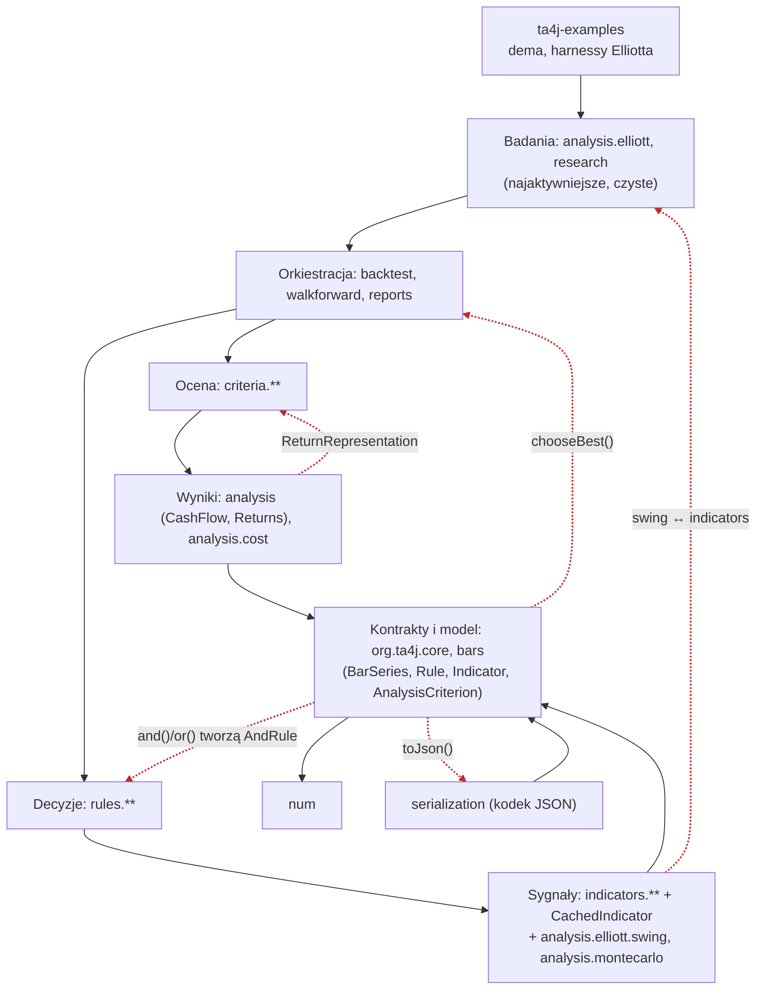

# Mapa repo ta4j: przewodnik na pierwszy dzień

Synteza trzech artefaktów: [`artifact-1-territory.md`](artifact-1-territory.md) (aktywność w gicie), [`artifact-2-structure.md`](artifact-2-structure.md) (graf zależności jdeps) i [`artifact-3-contributors.md`](artifact-3-contributors.md) (kto zna który obszar). Stan na 2026-10-30, okno 12 miesięcy. Szczegóły i liczby są w artefaktach, tu tylko to, co potrzebne do orientacji.

Każde powiązanie ma oznaczone źródło:

| Znacznik | Skąd wiemy |
|---|---|
| **[git]** | Współzmiany w historii |
| **[graf]** | Import używany w runtime (jdeps + bajtkod) |
| **[unknown]** | Narzędzie tego nie objęło. To nie znaczy „brak powiązań”. |
| **[regen]** | Zmiana przez regenerację lub automat, a nie ręczną edycję |

## 1. TL;DR

ta4j to biblioteka Javy (25, Maven) do analizy technicznej i backtestingu strategii tradingowych. Ma dwa moduły: `ta4j-core` (biblioteka) i `ta4j-examples` (dema, wykresy, harnessy kalibracyjne). Do tego dochodzą `scripts/` (automatyzacja wydań w bash, Pythonie i PowerShellu) oraz `.github/workflows`.

Kod układa się w warstwy: model danych (`BarSeries`) → wskaźniki → reguły i wyniki finansowe → kryteria oceny → backtest. Kilka pojedynczych importów „w górę” spina je jednak w jeden splot 37 pakietów.

Praca idzie dwoma nurtami:
- **badania fal Elliotta**, najaktywniejszy i rosnący obszar, strukturalnie czysty,
- **fundamenty silnika:** seria notowań, cache wskaźników, krzywa kapitału, backtest.

Boli w fundamentach:
- współbieżne mutacje świec (otwarte #1642/#1643),
- cache wskaźników (4 błędy po wydaniu),
- kontrakty `core`, których zmiana kaskadowo dotyka kryteriów, analizy i backtestu.

Zespół to w praktyce jeden maintainer, więc na prawie każde pytanie odpowiada ta sama osoba.

Strzałki ciągłe to zależności zgodne z warstwami **[graf]**. Czerwone przerywane to importy w górę, które zamykają cykle **[graf]**. Ostatnią krawędź (`swing` ↔ `indicators`) narysowano w uproszczeniu: `analysis.elliott.swing` leży w tym samym pudełku co `indicators`, a zależność w obie strony biegnie między nimi.

## 2. Teren

### Duża odpowiedzialność i peryferia

| Obszar | Rola | Sygnał |
|---|---|---|
| Kontrakty `org.ta4j.core` (37 plików) | Wszystko od nich zależy | fan-in 7 pakietów; z samych `criteria` 178 zależności między plikami, z `rules` 145 **[graf]** |
| Silnik wskaźników `indicators` (75 plików w pakiecie głównym + rodziny) | Hub obliczeń | `CachedIndicator` to plik nr 2 pod względem zmian **[git]** |
| Wyniki finansowe `analysis`, `criteria` (18 + 84 plików) | Ocena każdej strategii | `CashFlow` to plik nr 1 **[git]** |
| Badania Elliotta (`analysis/elliott` 50, `indicators/elliott` 56, `swing` 19, dema 15) | Najaktywniejszy nurt | 237 commitów w rdzeniu, Q4: 18% całej pracy **[git]** |
| Peryferia: `num`, `bars`, `aggregator`, `portfolio`, `research`, `walkforward` | Stabilne lub rzadko zmieniane | Poza top 10 aktywności **[git]** |

### Moduły głębokie i płytkie

To ocena jakościowa na podstawie rozmiaru i roli, a nie metryka.

- **Głębokie** (mały interfejs, dużo ukrytej logiki):
  - `CachedIndicator` (cache, rekurencja, rewizje serii),
  - `CashFlow` (tryby krzywej kapitału),
  - `serialization` (11 plików obsługujących wszystkie komponenty),
  - silnik badań `analysis/elliott`.

  Tu zmiana jest najdroższa.
- **Płytkie** (dużo małych klas):
  - `criteria` (84 pliki, zwykle po jednej formule),
  - `rules` (81),
  - fasady `*Facade` w `indicators`,
  - `utils`.

  Tu zmiany są lokalne i tanie.

### Aktywność w czasie [git]

Tempo rosło przez cały rok:

| Kwartał | XI–I | II–IV | V–VII | VIII–X |
|---|---|---|---|---|
| Commity | 104 | 215 | 415 | 1092 |

Nacisk przesuwał się kolejno:
1. dema Elliotta (III, PR #1448),
2. wydania i prognozy (V–VII, CF-289),
3. statystyka, backtest i kryteria (VIII–IX, CF-453/454, SPC, #1613),
4. badania Elliotta w rdzeniu (X, CF-586 – CF-590).

`core` i `indicators` to stałe tło przez cały rok.

### Gdzie katalogi nie odpowiadają realnej aktywności

- **Jedna funkcja produktu (fale Elliotta) leży w czterech miejscach:**
  - `analysis/elliott` (badania),
  - `indicators/elliott` (wskaźniki live),
  - `analysis/elliott/swing` (detektory używane przez wskaźniki),
  - `ta4j-examples/.../elliottwave` (kalibracja).

  Do tego plik nr 9 rankingu, `ElliottResearch.java`, leży w `src/test`, bo to harness badawczy, a nie test.
- **W `indicators` jest 14 typów, które nie są wskaźnikami** (runnery, wyniki, fasady), wbrew `indicators/AGENTS.md`. Należy do nich `ElliottWaveAnalysisRunner`, plik nr 10.
- **Pakiet `analysis` miesza dwa poziomy:** krzywe kapitału (`CashFlow`, `Returns`) oraz ogólne prymitywy (`AnalysisRunner`, `WeightedValue`), których używają wskaźniki.
- **Typy w nieoczekiwanych pakietach:**
  - `analysis.cost` to w praktyce część modelu transakcji,
  - `criteria.ReturnRepresentation` to słownik używany przez prognozy.
- **Ukryte „projekty”:** `ta4j-examples` działa jak warsztat badawczy (harnessy kalibracyjne z dużą aktywnością), a `scripts/` jak osobny produkt (145 commitów, automatyzacja wydań).

## 3. Realne powiązania

| Co zmienia się razem | Siła | Źródło | Przyczyna |
|---|---|---|---|
| `core` → `analysis` → `criteria` → `backtest` | Trójka 15 commitów; para `analysis` + `criteria` 37% | **[git] + [graf]** | Zmiana kontraktu serii (okna, snapshoty) rozlewa się w dół kaskady. Cykl zamyka m.in. 1 import `AnalysisCriterion → BarSeriesManager`. |
| `analysis` ↔ `criteria` | 31 commitów na istniejących plikach | **[git] + [graf]** | `Returns` → `criteria.ReturnRepresentation` (enum w złej warstwie). Dawny wspólny `EquityCurveCache` usunięto 2026-09-26. |
| `indicators` ↔ `indicators/averages`, `helpers`, `zigzag` | 54% / 44% / 50% zmian mniejszego pakietu | **[git] + [graf]** | Rodziny wskaźników dziedziczą po `CachedIndicator`, a złożone wskaźniki w pakiecie głównym używają rodzin. Hub bez granicy. |
| `analysis/elliott/swing` ↔ `indicators`, `indicators/elliott` | 10/10 i 7/9 zależności w obie strony; 16 wspólnych commitów | **[graf] + [git]** | Przeniesienie detektorów w VII (`a954132ee`) zmieniło katalog, ale nie zależności. |
| `analysis/event` ↔ `indicators/statistics` | 73% | **[git]** (graf: brak cyklu) | Jedna kampania CF-453/454. Kod nowy i odseparowany. |
| `indicators/elliott` ↔ `examples/elliottwave` | 37% | **[git]** (graf: tylko examples → core) | Kalibracja demem w III. Zależność jednokierunkowa, więc sprzężenie jest czasowe. |
| `BaseBar` ↔ `BaseBarSeries` | Pętla 2 plików | **[graf] + [git]** | Kontrakt mutacji świec (#1618, #1642/#1643). |
| `scripts/`, `.github/workflows` z resztą | — | **[unknown]** | Bash, Python i PowerShell bez grafu zależności. Znamy tylko współzmiany z gita. |
| Testy (696 plików w core) z kodem | — | **[unknown]** w grafie | jdeps objął tylko kod produkcyjny. Historia gita liczy testy razem z kodem. |
| Zasoby testowe (`src/test/resources`) | — | **[unknown]** w grafie, [git] | Dane, nie kod. Część to wektory referencyjne **[regen]** (niżej). |

### Zmiany przez regenerację lub automat [regen]

Są tańsze niż ręczna edycja:
- **Wersje w `README.md` i `pom.xml` oraz sekcje wydań w `CHANGELOG.md`:** bot wydań (14 commitów), skrypt `scripts/prepare-release.sh`.
- **Grafiki i fragmenty kodu w README:** `ReadmeContentManager` (uruchamiany ręcznie, nie w buildzie).
- **Wektory referencyjne filtrów** (`src/test/resources/.../indicators`): „regenerate CF-558 MCKF reference vectors”. Generator w Pythonie usunięto po wygenerowaniu danych.
- **Formatowanie** (spotless/formatter, 71 commitów) oraz masowe zmiany SPDX i JUnit 5: odfiltrowane z analizy aktywności.

## 4. Strefy ryzyka

Każdą strefę wspierają co najmniej dwa niezależne sygnały. Sygnały o wspólnej przyczynie liczyłem raz.

1. **Notowania na żywo: aktualizacja świec i współbieżny odczyt serii.**
   Kod: `ta4j-core/src/main/java/org/ta4j/core/BaseBar.java`, `BaseBarSeries.java`, `ConcurrentBarSeries.java`.
   Dlaczego: otwarte błędy rozdartych odczytów #1642/#1643 bez osoby przypisanej, pętla runtime `BaseBar`↔`BaseBarSeries` **[graf]** oraz 12 poprawek po wydaniu w PR #1618 **[git]**.
2. **Poprawność wartości wskaźników przy napływie nowych danych (cache).**
   Kod: `ta4j-core/src/main/java/org/ta4j/core/indicators/CachedIndicator.java`, `RecursiveCachedIndicator.java`.
   Dlaczego: 4 niezależne błędy po wydaniu w tym samym mechanizmie (#1638, #1646, #1676, #1704) **[git]** oraz hub bez granicy pakietowej, przez który zmiana dotyka wszystkich rodzin wskaźników **[graf]**.
3. **Wynik finansowy strategii: krzywa kapitału, PnL i zwroty.**
   Kod: `ta4j-core/src/main/java/org/ta4j/core/analysis/CashFlow.java`, `CumulativePnL.java`, `Returns.java`, `criteria/ReturnRepresentation.java`.
   Dlaczego: najczęściej zmieniany plik repo i revert CF-236 **[git]** oraz cykl `analysis`↔`criteria` przez enum w złej warstwie i globalna mutowalna `ReturnRepresentationPolicy` **[graf]**.
4. **Definiowanie i ocena strategii: kontrakty reguł, strategii, wskaźników i kryteriów.**
   Kod: `ta4j-core/src/main/java/org/ta4j/core/Rule.java`, `Strategy.java`, `Indicator.java`, `AnalysisCriterion.java`.
   Dlaczego: największy zasięg zmiany (`criteria` 178 i `rules` 145 zależności) oraz importy w górę (`AndRule`, `BarSeriesManager`, serializatory) **[graf]**. `core` ma najwyższy odsetek poprawek (25%) **[git]**. Brak pakietów `internal`, więc każda zmiana dotyczy publicznego API.
5. **Wykrywanie szczytów i dołków (swingi), wspólne dla fal Elliotta i wskaźników.**
   Kod: `ta4j-core/src/main/java/org/ta4j/core/analysis/elliott/swing/` (np. `FractalSwingDetector.java`), `ta4j-core/src/main/java/org/ta4j/core/indicators/zigzag/`.
   Dlaczego: zależność w obie strony z `indicators` i `indicators/elliott` **[graf]** oraz współzmiany z najaktywniejszym obszarem (`zigzag` 44%) **[git]**.

**Do obserwacji, poza listą stref:** zapis i odtwarzanie strategii w JSON (`ta4j-core/src/main/java/org/ta4j/core/serialization/`). Są cykle z kontraktami i plik wspólny dla 20 obszarów, ale część współzmian to konwencja „każdy wskaźnik ma pokrycie serializacji”, a brakuje sygnału błędów po wydaniu.

### Wygląda groźnie, ale nie jest

| Sygnał | Dlaczego to fałszywy alarm |
|---|---|
| `CHANGELOG.md` zmienia się razem z 74 obszarami | Workflow wymuszony regułą PR (PR.RULE.CHANGELOG_STYLE). Kosztem są konflikty przy merge, a nie sprzężenie kodu. Jedna przyczyna. |
| Duży odsetek poprawek w `indicators/statistics` (17%) i `analysis/elliott` (22%) | To rundy review przed merge'em (CodeRabbit, Codex, „round-34”). Po wydaniu 0 poprawek w statistics. |
| Seria commitów w `scripts/` (V–VIII) | Dopracowywanie CI i release schedulera metodą prób i błędów. |
| `config/spotbugs/known-debt-filter.xml` (38 obszarów) | Konfiguracja długu, usunięta 2026-07-03 po spłacie w CF-236. |
| Klaster `analysis`↔`criteria` wokół `EquityCurveCache` | Plik usunięty. Sprzężenie trzyma się dziś na `CashFlow` i `Returns` (strefa 3, liczone raz). |
| 22 importy `serialization` i 17 importów `ReturnRepresentation` | Kodek i wspólny enum z założenia. Problemem jest tylko lokalizacja enuma (strefa 3). |
| Splot 37 pakietów | To nie 37 problemów. Trzymają go pojedyncze krawędzie w górę (strefa 4). Bez krawędzi z `core` zostaje 28. |
| Wersje w `README.md` i `pom.xml`, wektory CF-558, grafiki README | **[regen]**: automat albo regeneracja, a nie ręczna edycja. |
| 5 revertów w roku | Małe i jednorazowe. Jedyny duży (Jules, 22 X) to commit na nieaktualnej bazie, a nie słabość obszaru. |

## 5. Kogo zapytać

Prawie cała wiedza jest u jednej osoby. „David Pang” i „TheCookieLab” najpewniej są tą samą osobą: podpisują się tym samym adresem, ale to nie jest potwierdzone. Przy takim zespole to norma, a nie ryzyko.

| Strefa | Pierwszy kontakt | Drugi kandydat (temat) |
|---|---|---|
| 1. Świece na żywo i współbieżność | David Pang (autor `ConcurrentBarSeries`, #1618) | Francesco: pod-serie i `maxBarCount` (#1410) |
| 2. Cache wskaźników | David Pang (86% zmian w plikach cache) | `vstoyanov`: zgłaszający #1666, scenariusz przesuwnej serii (użytkownik, nie autor) |
| 3. Krzywa kapitału i zwroty | David Pang (autor `ReturnRepresentationPolicy`) | **Francesco**: realized equity w `CashFlow`, Sharpe, Sortino (#1405, #1425, #1406, #1439) |
| 4. Kontrakty strategii i kryteriów | David Pang (polityka zmian łamiących API, serializacja #1373) | Francesco: perspektywa implementującego kryteria |
| 5. Swingi | David Pang (92% zmian w `swing`) | Saulo Gil: użytkownik `ElliottWaveFacade` (#1528), wpływ zmian API |

## 6. Pierwszy dzień: co przeczytać, w tej kolejności

1. **`AGENTS.md` i `PULL_REQUESTS.md`** (katalog główny): zasady gry, czyli obowiązkowa bramka buildu (`scripts/run-full-build-quiet.sh`) i wpis w `CHANGELOG.md`.
2. **`ta4j-core/src/main/java/org/ta4j/core/package-info.java`**: mapa kontraktów i wskazanie punktów wejścia.
3. **`ta4j-core/src/main/java/org/ta4j/core/BarSeries.java`**, potem `BaseBarSeries.java` i `BaseBar.java`: model danych i strefa ryzyka 1.
4. **`ta4j-core/src/main/java/org/ta4j/core/Indicator.java`** i **`indicators/CachedIndicator.java`** (razem z `ta4j-core/src/main/java/org/ta4j/core/indicators/AGENTS.md`): jak liczą się wskaźniki, strefa ryzyka 2 i reguła przestrzeni `indicators`.
5. **`ta4j-core/src/main/java/org/ta4j/core/Rule.java`** i **`Strategy.java`**: od sygnału do decyzji.
6. **`ta4j-core/src/main/java/org/ta4j/core/backtest/BarSeriesManager.java`**: główny punkt wejścia backtestu.
7. **`ta4j-core/src/main/java/org/ta4j/core/analysis/CashFlow.java`** i **`AnalysisCriterion.java`**: jak ocenia się wynik, strefy ryzyka 3 i 4.
8. **`ta4j-core/src/main/java/org/ta4j/core/analysis/elliott/package-info.java`**: wejście do najaktywniejszego obszaru, jeśli praca dotyczy Elliotta.

## 7. Ograniczenia

- **Okno czasowe: 12 miesięcy** (2025-10-30 – 2026-10-30). Obszary stabilne od dawna wyglądają na „peryferia”, nawet jeśli są krytyczne (np. `num`).
- **Aktywność to liczba commitów, a nie wysiłek.** Kategorie tematów przypisano automatycznie po słowach kluczowych, więc liczby są przybliżone. Ok. 5% commitów to commity agentów AI. Wiele ludzkich commitów powstało z ich pomocą, więc autorstwo nie równa się wiedzy.
- **Graf zależności obejmuje tylko kod produkcyjny Javy** (stan na HEAD z 2026-10-30). `scripts/`, `.github/workflows`, testy, zasoby i dokumentacja to **[unknown]** w grafie. Brak krawędzi tam nie oznacza braku powiązań.
- **Graf jest statyczny.** Nie widzi refleksji: serializacja tworzy komponenty po nazwie typu, a rejestr strategii skanuje pakiety. Te powiązania są niedoszacowane.
- **Model warstw L0–L7 wyprowadzono z `package-info.java`.** Repo deklaruje jawnie tylko regułę przestrzeni `indicators`. Inny model warstw dałby inne naruszenia.
- **Mapa nie mówi nic o:** wydajności, pokryciu testami, jakości dokumentacji, użyciu API przez zewnętrznych użytkowników ani o planach rozwoju (poza tym, co widać w ticketach CF-xxx).
- **Usunięte pliki** (15% plików z okna) połączono z historią albo oznaczono w artefaktach. Wszystkie ścieżki z sekcji 4 i 6 sprawdzono w repo 2026-10-30.
